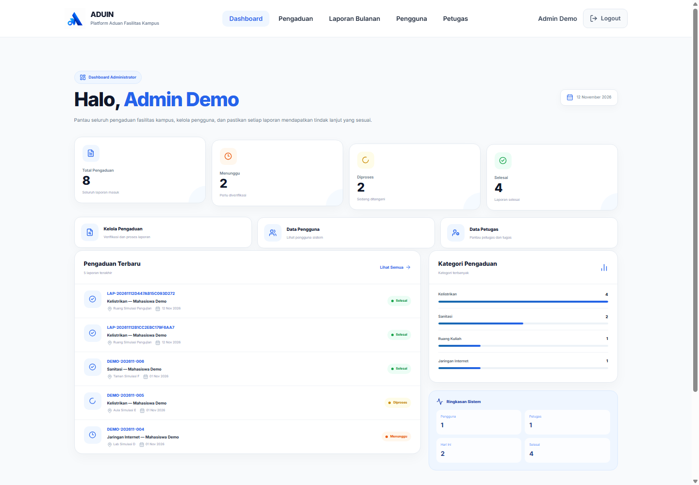
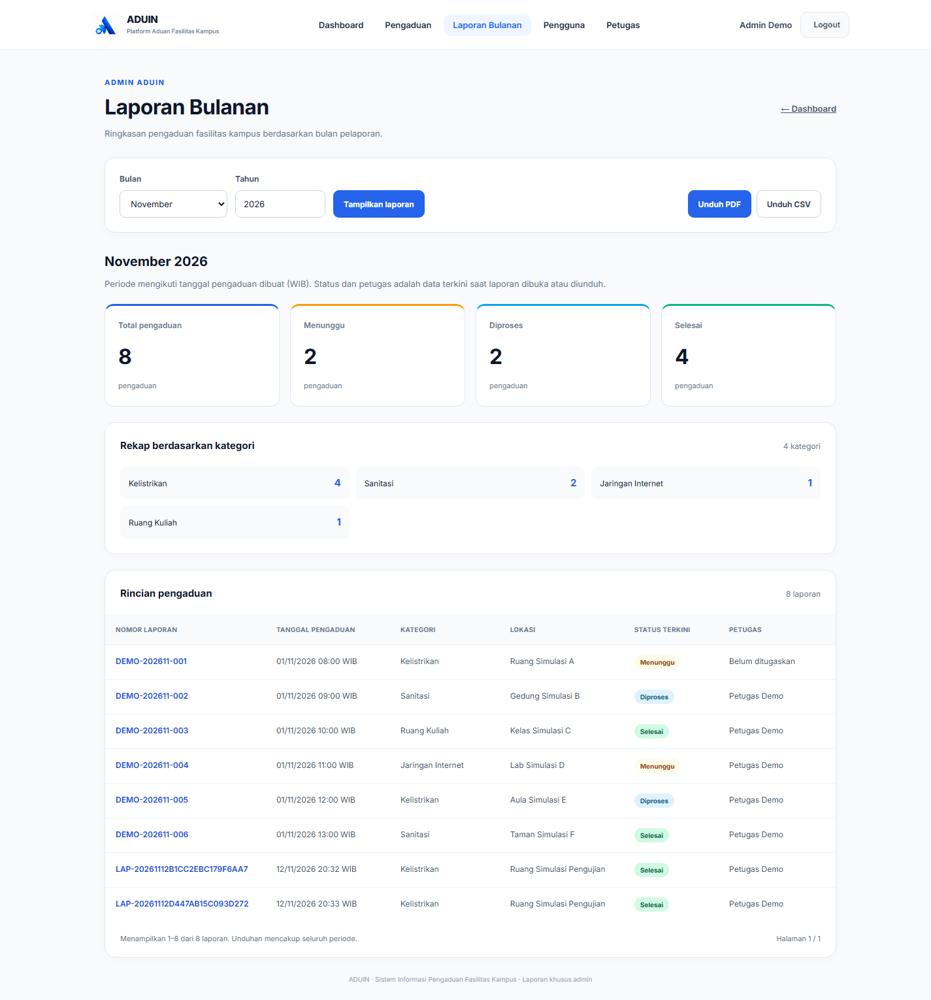

# ADUIN — Sistem Pengaduan Fasilitas Kampus

ADUIN adalah aplikasi **PHP Native + MySQL** untuk melaporkan kerusakan fasilitas kampus, menugaskan petugas, memantau penanganan, dan menyusun laporan bulanan. Repositori portofolio ini memuat source aplikasi lengkap dari versi fitur laporan bulanan, konfigurasi contoh, struktur database, serta pembuat data demo sintetis.

**Demo aplikasi:** [aduin-kampus.rf.gd](https://aduin-kampus.rf.gd). Demo online dikelola terpisah; akun lokal yang dibuat di bawah hanya berlaku pada instalasi Anda. Isi dan ketersediaan demo online tidak diverifikasi dalam penyiapan repositori ini.

## Fitur

| Akses | Fitur yang tersedia |
| --- | --- |
| Mahasiswa (`pengguna`) | Login, dashboard statistik pribadi, membuat pengaduan berkategori/lokasi/deskripsi, unggah foto opsional, nomor laporan, serta riwayat pengaduan. |
| Admin | Dashboard seluruh pengaduan, pencarian/filter, detail dan riwayat penanganan, penugasan petugas, daftar pengguna dan statistik petugas, serta laporan bulanan. |
| Petugas | Dashboard tugas, daftar tugas yang ditugaskan, pembaruan status Menunggu → Diproses → Selesai, catatan/foto perbaikan, riwayat tugas, pembaruan profil dan password. |
| Tracking | Pelacakan status dan linimasa menggunakan nomor laporan; foto tetap memerlukan autentikasi dan otorisasi. |
| Laporan bulanan admin | Filter bulan/tahun, ringkasan status dan kategori, detail dengan paginasi, unduh **PDF A4 lanskap** dan **CSV UTF-8**. Periode memakai tanggal pembuatan pengaduan; status/penugasan mengikuti keadaan saat unduh. |

Keamanan aplikasi mencakup prepared statements pada operasi berparameter, hash password, pemeriksaan role dan kepemilikan data, CSRF, pembatasan percobaan, validasi serta pengodean ulang gambar, header keamanan, dan perlindungan formula CSV. Source integrasi WhatsApp tetap tersedia di `services/`, tetapi **nonaktif** pada template dan tidak memuat token atau penerima.

## Teknologi dan kebutuhan

- PHP 8.3 (versi yang digunakan untuk verifikasi), Apache 2.4 dengan `mod_rewrite`, MySQL 8.4 (versi pengujian).
- Ekstensi PHP: `mysqli`/`mysqlnd`, `mbstring`, `fileinfo`, `gd`, `zlib`, `session`, dan `json`; `curl` hanya untuk integrasi WhatsApp opsional.
- HTML, CSS, JavaScript; Lucide, GSAP, Lenis, dan Inter melalui CDN. Koneksi internet diperlukan untuk ikon, font web, dan animasi eksternal.
- tFPDF 1.34 dan DejaVu disertakan untuk menghasilkan PDF lokal tanpa Composer. Lisensi ada pada [catatan dependensi](THIRD_PARTY_NOTICES.md).

## Struktur folder

```text
ADUIN/
├── admin/                 # Administrasi dan unduh laporan bulanan
├── user/                  # Dashboard, pengajuan, dan riwayat mahasiswa
├── petugas/               # Tugas, penanganan, riwayat, profil
├── assets/                # CSS, JavaScript, logo aplikasi
├── config/
│   ├── database.php       # Koneksi melalui konfigurasi privat
│   └── example.local.php  # Template tanpa kredensial
├── includes/              # Bootstrap, keamanan, navbar, laporan, tFPDF/font
├── services/              # Renderer PDF dan source integrasi WhatsApp
├── database/schema.sql    # Struktur saja; tidak berisi data akun
├── bin/seed-demo.php      # Pembuat data sintetis; hanya CLI
├── storage/rate-limits/   # Kosong; data runtime diabaikan Git
├── uploads/               # Kosong; unggahan diabaikan Git
├── docs/screenshots/      # Screenshot lokal memakai data sintetis
├── tests/                 # Pemeriksaan laporan dan keamanan data publik
├── index.php              # Halaman awal
├── login.php / logout.php
├── pengaduan.php / tracking.php / media.php
├── .htaccess / .gitignore
└── GITHUB_PUBLICATION_AUDIT.md
```

## Instalasi lokal dengan Laragon

1. Aktifkan Apache dan MySQL di Laragon. Pastikan PHP 8.3 serta ekstensi di atas aktif (`php -m`).
2. Salin/clone repositori ke folder web Laragon dengan nama `aduin`. Jalankan **Reload** untuk virtual host `http://aduin.test`, atau gunakan `http://localhost/aduin`. Root virtual host harus menunjuk langsung ke folder yang berisi `index.php`.
3. Melalui HeidiSQL/phpMyAdmin, buat database **baru dan kosong** bernama `aduin_demo` dengan charset `utf8mb4`. Jangan memilih database proyek lama atau hosting.
4. Pilih database tersebut dan impor **hanya** `database/schema.sql`. File ini tidak memuat `DROP`, `TRUNCATE`, data pengguna, atau hash password. Contoh terminal Laragon:

   ```console
   mysql -u root -p -e "CREATE DATABASE aduin_demo CHARACTER SET utf8mb4 COLLATE utf8mb4_unicode_ci"
   mysql -u root -p aduin_demo
   ```

   Pada prompt MySQL, jalankan `SOURCE database/schema.sql;` dari root repositori. Jika database sudah ada, gunakan database demo kosong yang baru; jangan menghapus data lama.

5. Buat konfigurasi privat:

   ```powershell
   Copy-Item config/example.local.php config/local.php
   ```

   Edit `config/local.php`: isi `DB_USER` dan `DB_PASS` sesuai MySQL lokal Anda, pastikan `DB_NAME=aduin_demo`, `APP_ENV=local`, `WA_ENABLED=false`, serta `APP_BASE_URL=http://aduin.test` atau `http://localhost/aduin`. Sesuaikan port jika perlu. Template sengaja tidak menetapkan username/password database. `config/local.php` tidak boleh dipublikasikan.

6. Dari terminal Laragon di root repositori, buat demo:

   ```console
   php bin/seed-demo.php
   ```

   Skrip hanya menerima database lokal demo/test dengan struktur yang tepat dan **seluruh tabel kosong**. Skrip membuat tiga akun `admin@example.invalid`, `mahasiswa@example.invalid`, dan `petugas@example.invalid` dengan **password acak baru**, ditampilkan sekali di terminal. Hash dibuat saat itu melalui `password_hash()` dan tidak disimpan di source. Simpan password secara privat. Menjalankan ulang pada database berisi data akan ditolak.

7. Buka aplikasi, login sesuai role, lalu tinjau enam pengaduan sintetis dengan variasi status. Data laporan berada pada **bulan saat seed dijalankan**; pilih bulan tersebut pada menu Laporan Bulanan. Gunakan nomor berawalan `DEMO-` dari riwayat untuk mencoba tracking.
8. Pastikan PHP dapat menulis ke `uploads/pengaduan`, `uploads/perbaikan`, dan `storage/rate-limits`. Cache/metrik font tFPDF sudah disertakan; tidak perlu membuat folder kode dapat ditulis.

Gunakan Apache untuk pemakaian lokal ini: server bawaan `php -S` tidak menerapkan `.htaccess` atau aturan akses lampiran. Jangan mengekspos server pengembangan ke internet.

## Screenshot portofolio

Screenshot hanya diambil dari instalasi lokal dengan akun dan pengaduan sintetis. Tidak ada foto pengguna atau tangkapan layar hosting yang disalin. Galeri dan keterangan ada di [docs/screenshots/README.md](docs/screenshots/README.md).





## Verifikasi dan publikasi

```console
php tests/report-smoke.php
python tests/audit-publication.py
```

Lint seluruh PHP dapat dijalankan dari PowerShell:

```powershell
Get-ChildItem -Recurse -File -Filter *.php | ForEach-Object { php -l $_.FullName }
```

Hasil verifikasi aktual, batasan pengujian, pengecualian berkas, dan manifest dicatat pada [GITHUB_PUBLICATION_AUDIT.md](GITHUB_PUBLICATION_AUDIT.md). Periksa kembali audit sebelum memilih file untuk commit. Paket ini disiapkan untuk ditinjau; repository remote, push, dan unggahan memerlukan persetujuan pemilik.
