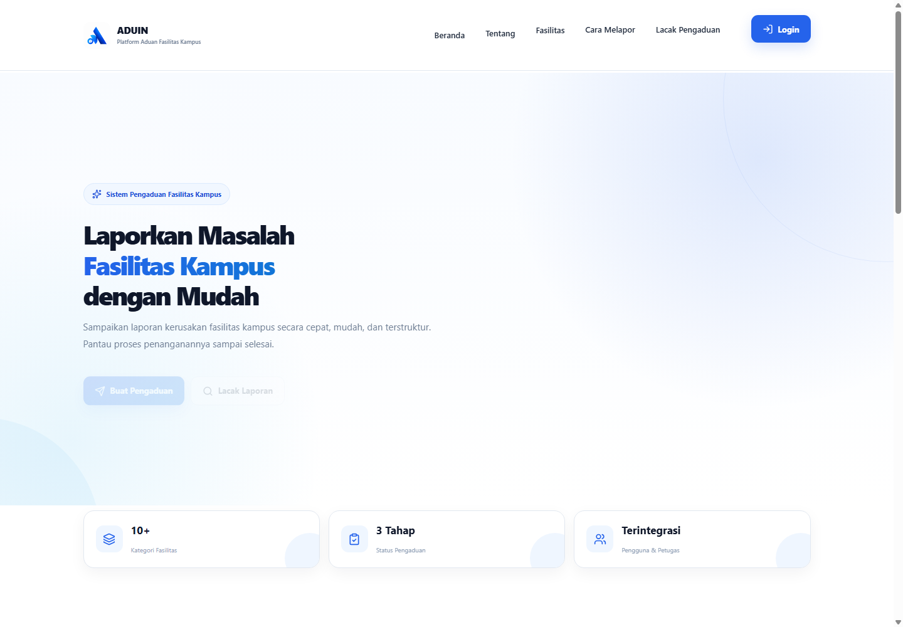
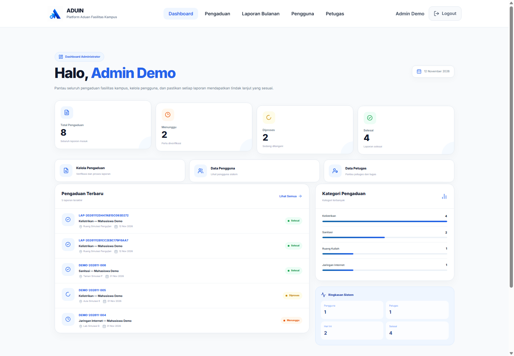
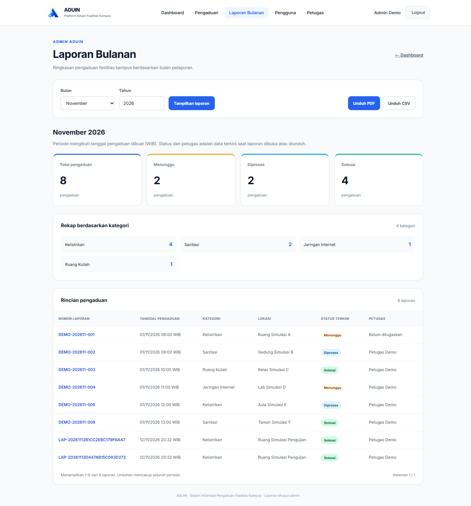
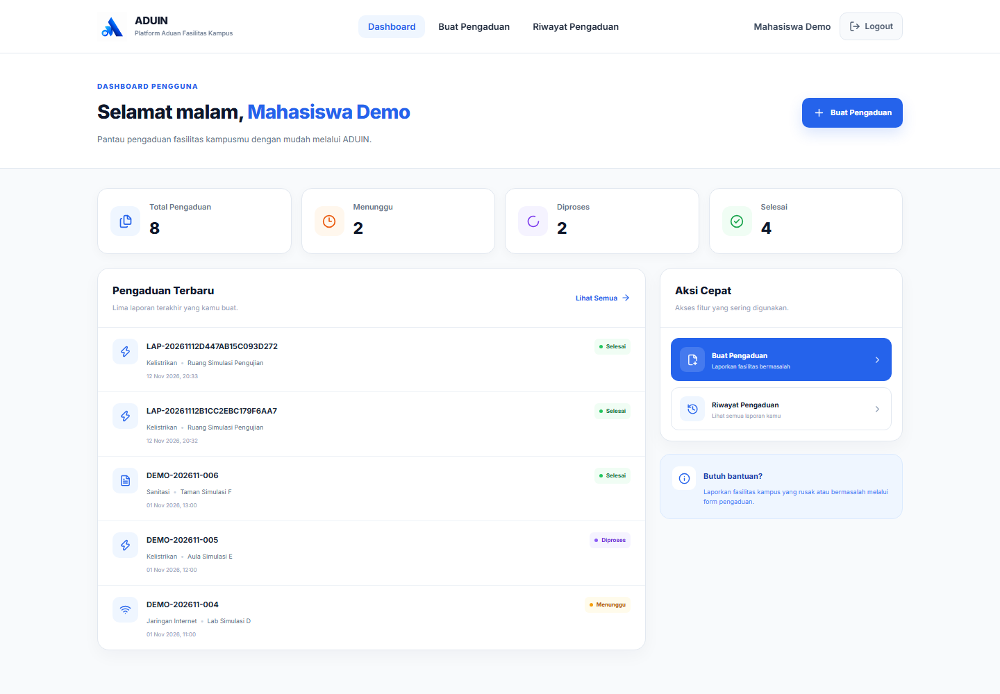
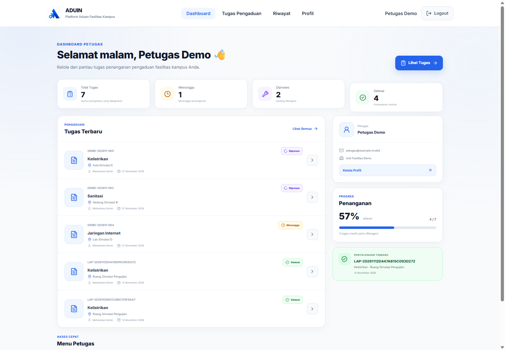
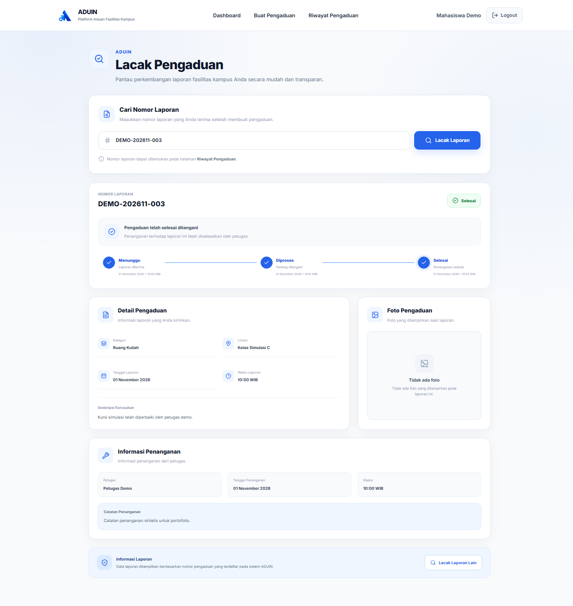
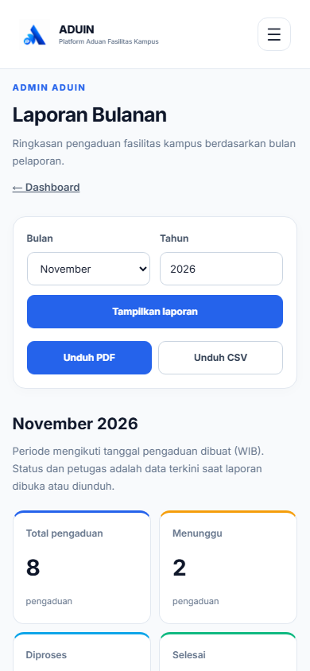

# Screenshot portofolio

Ketujuh screenshot ini ditangkap pada 12 November 2026 dari runtime lokal dengan identitas dan pengaduan sintetis. Tidak ada tangkapan layar hosting atau foto pengguna. Alamat email memakai domain `example.invalid`; nomor WhatsApp dan foto pada fixture kosong. Screenshot tidak memuat address bar, path komputer, password, token, cookie, atau sesi browser. Delapan pengaduan yang terlihat mencakup enam fixture dasar dan dua simulasi pengujian alur.

Ukuran desktop 1440 × 1000 piksel (halaman panjang ditangkap penuh), seluler 390 × 844 piksel. Gambar merupakan tampilan aplikasi aktual; metadata screenshot tidak memuat teks/EXIF atau sesi.

## Beranda

## Dashboard admin

## Laporan bulanan dan tombol PDF/CSV

## Dashboard mahasiswa

## Dashboard petugas

## Tracking dengan akun pemilik laporan

## Laporan bulanan pada layar seluler

